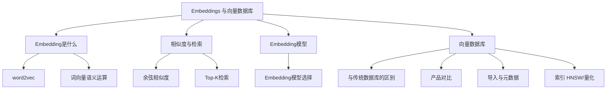

# Embeddings 与向量数据库（领域 MOC）

> L1 骨架 · 第一领域。概貌来自 9/9 课件 PDF，抓取只做挂载。

## 四大支柱
1. [[Embedding是什么]] — 概念：任何物体 → 向量
2. [[相似度与检索]] — 计算：余弦 + Top-K
3. [[Embedding模型]] — 选型：维度 / 语言 / 成本
4. [[向量数据库]] — 存储与索引

## 骨架拓扑

## 学习状态
- [ ] 骨架经唐审
- [ ] Q&A 深挖（提问式）
