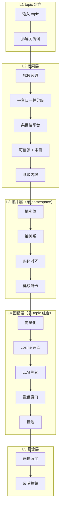

# 五层架构



## 数据流与落盘

| 层 | 输入 → 输出 | 落盘 |
|---|---|---|
| L1 topic 定向 | str → list[str] | — |
| L2 检索层 | keywords → list[Source] + list[SourceEntry] | `config/sources.yml` + `data/settings/settings.json` |
| L3 拓扑层 | sources → Namespace | `data/wiki/`（双链卡，git 真相源） |
| L4 图谱层 | Namespace → list[Edge] | `data/graph/edges.md` |
| L5 画像层 | events → Profile | 待定 |

## L2 检索层 · 可信源两层模型（2026-10-12 定）

可信源**分两层**，因为「平台」与「文件」是两种不同粒度的事实：

```
可信源（Source，平台级，全局一份）   条目（SourceEntry，文件级，挂主题模块下）
{ id: 宿主域名, name, type, why,   { title, source: 平台id,
  home, origin }                    locator, note }
```

| 层 | 粒度 | 例子 | 复用性 |
|---|---|---|---|
| 可信源 | 站 / 出处 | GitHub、arXiv、Oracle 官方文档、JCP 规范库 | **跨主题复用**（全局注册表，搜十个主题仍只一个 GitHub） |
| 条目 | 文件 / 页面 / 章节 | arXiv 上某篇论文、openjdk/jdk 仓库、JLS §17.4 | 依附主题，只对本主题有意义 |

为什么必须拆：混成一层的话，每搜一个主题就多攒几条「可信源」，没有任何一条可复用——等于没有。
**收敛靠机制而不是靠模型自觉**：`retrieve.normalize_platforms` 按 `locator` 的**宿主域名**归一
（`github.com` 无论写成 GitHub / github / GH 都是同一个平台），可信度分级（规范/源码最高 → 社区最低）
也定在**平台**上，因为「这个站是什么性质」是跨主题成立的事实。

**内置主题模块**（`config/sources.yml`）与用户模块**同构**，只是来路不同：

```
模块 = { id, topic, origin, keywords, items: [SourceEntry] }
        origin: auto（AI 搜主题时判定后自动收录）| manual（设置页手工建/改过）
```

查找顺序（四级，命中即止）：

| 级 | 来源 | 落点 |
|---|---|---|
| 1 | 内置主题模块 | `config/sources.yml` 的 `domains`（随仓库走的 curated 真相源） |
| 2 | 用户模块 | `data/settings/settings.json`（**先按 topic 精确命中**——缓存键就是 topic；再按 keywords/条目标题/平台名 包含匹配补充） |
| 3 | **AI 判定并自动收录** | 前两级都空 → 模型按 `prompts/sourcing.md` 出「平台 + 条目」→ 平台补进全局注册表、条目落成 `origin=auto` 模块 |
| 4 | 都没有 | `needsConfig=True`，界面提示去配置 |

关键约束：
- 收录**保守**：模型必须同时给出平台与条目，否则不落盘（不污染设置）；
- **可信源必须由条目支撑**：没有条目的平台是噪声，归一后直接丢；条目连域名都没有时也丢（挂不上任何东西）；
- 引用悬空（平台被删过）时按条目域名**就地兜底补一个**，类型取最低档「博客」——宁可给一条可改的兜底，也不让整次搜索白跑；
- 模块被手工改过 → `origin` 翻成 `manual`（不再被当纯 AI 生成）；
- 离线（无 LLM key）时 `llmAvailable=False`，界面据此解释「为什么没自动生成」；
- 匹配口径（`settings.matches_keywords`）：**ASCII 整词、中文子串**。子串匹配会让 `transform`
  命中「Sentence Transformers」、`ai` 命中 `FAISS`，把不相关的源当成「找到了」端给用户。
  ⚠ 平台 **id（域名）不参与匹配**：`ai` 会整词命中 `faiss.ai`；平台名可以（GitHub / arXiv 是有意义的锚点）。

## 搜索历史（L1·L2 输入侧的持久化，2026-10-12）

搜过的主题落 `data/settings/settings.json` 的 `history`（与 `modules` / `platforms` 同文件、分段写，
谁写也不动另外两段）：
`{topic, at, matched, sourceCount}`，同主题只保留一条（再搜 = 顶到最前），上限 20。

- 侧栏「搜索」正下方就是这份历史的视图，点了回搜该主题（`/search?topic=…`）；
- 记录点在 `retrieve.search_topic()`（CLI 与界面同一条路），`draft` 预演传 `record_history=False` 保持零副作用。

## 模型资源层（`app/llm.py` + `app/settings.py`）

业务层只写「要 JSON」，不问「哪家的哪个模型」。资源事实**在界面上配**（右下角 ⚙ → 模型），
落 `data/settings/llm.json`（不入 git）；`.env` 只做**播种**——文件一旦存在即为唯一真源：

| 项 | 落点 |
|---|---|
| 资源（家） | provider = `id + baseUrl + 凭据`；凭据可写明文 `apiKey`，或 `apiKeyEnv` **引用环境变量**（密钥不落盘，默认家就是这么播的） |
| 调用形态 | 只有一个（OpenAI 兼容 `POST /chat/completions`），故不设 adapter 注册表 |
| 有序降级链 | 每档位一条链（`main` / `cheap`），写 `<model>`（默认家）或 `<provider>/<model>`，**按顺序 = 尝试顺序** |
| 模式 | `fallback` = 逐个试到成功；`moa` = 链上都问一遍再融合 |
| 有界 | `maxAttempts`（链再长也不会无限打）；`timeout` 是单次尝试超时 |

**降级判据**：超时/连不上/5xx/429/401/模型不存在/**空响应或非 JSON** → 换下一家；
HTTP 400（自己的入参错）→ 立即止损。降级**必须可见**（`last_llm_route` / `last_llm_degraded`）。

**MoA 融合规则**（`_fuse`）：列表取并集去重，标量取多数票、平票取**链序靠前**。
代价与收益摆明：一次业务打 N 次模型（成本/耗时 ×N，由 `maxAttempts` 封顶），换来更高召回与更少单模型抖动。
这与「人工审核」配套：**模型放宽召回，人来筛**。

**探活用真调**（`llm.probe`，设置页「测试连通」）：零成本 `GET /models` 会把「在清单里但调不通」的
模型判成可用（实测 `gpt-flash` 就在清单里却 503）——**真实调用定生死**。

不搬 x_ai 的 Redis 健康、主动探针、熔断冷却、级联恢复——本仓单进程同步、无多副本，那些机制没有触发者。

**明文 Key 的边界**：读接口从不回传明文（只给 `hasKey` + 脱敏提示），故保存时「留空 = 不改」；
要清掉一家就删这条 provider。

## L4 是价值层

- **cosine 召回**：解决「哪些相关」（候选），实现见 `app/rag/embed.py` + `fuse.py`。
- **LLM 判边**：解决「什么关系」（递进 / 借鉴），schema 见 `config/schema.yml`，prompt 见 `prompts/relation_typing.md`。
- **T 型**：递进 = 竖·深度；借鉴 = 横·广度。学习新知识变快 = 命中已有边。

## 升格闸门（两条，同一原则：被验证才升格）

1. 单 namespace → 图谱层：某机制被 ≥2 条跨域借鉴边命中 → 升格为全局机制节点。
2. 图谱层 → 云枢 RAG：被真实项目实践验证 → 升格为开发规约。

全程与云枢 RAG **物理隔离、单向**。
