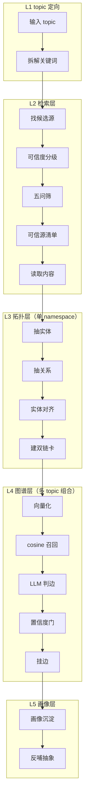

# 五层架构



## 数据流与落盘

| 层 | 输入 → 输出 | 落盘 |
|---|---|---|
| L1 topic 定向 | str → list[str] | — |
| L2 检索层 | keywords → list[Source] | `config/sources.yml` |
| L3 拓扑层 | sources → Namespace | `data/wiki/`（双链卡，git 真相源） |
| L4 图谱层 | Namespace → list[Edge] | `data/graph/edges.md` |
| L5 画像层 | events → Profile | 待定 |

## L2 检索层 · 可信源「模块」模型

可信源**按 topic 组织成模块**，不是扁平列表（2026-10-07 定）：

```
模块 = { id, topic, origin, keywords, sources[] }
        origin: auto（AI 搜主题时判定后自动收录）| manual（设置页手工建）
```

好处：**模块即缓存**。搜过的主题第二次直接命中，不再调用模型。

查找顺序（四级，命中即止）：

| 级 | 来源 | 落点 |
|---|---|---|
| 1 | 内置模块 | `config/sources.yml` 的 `domains`（随仓库走的 curated 真相源） |
| 2 | 用户模块 | `data/settings/settings.json`（按 topic/keywords/源名 匹配） |
| 3 | **AI 判定并自动收录** | 前两级都空 → 模型按 `prompts/sourcing.md` 提候选 → 落成 `origin=auto` 模块 |
| 4 | 都没有 | `needsConfig=True`，界面提示去配置 |

关键约束：
- 内置 `domains` 与用户 `modules` **同构**（同一个模型，两种来路）；
- 第 3 级收录**保守**：模型没给出合法源就不落盘，不污染设置；
- 模块被手工改过 → `origin` 翻成 `manual`（不再被当纯 AI 生成）；
- 离线（无 LLM key）时 `llmAvailable=False`，界面据此解释「为什么没自动生成」。

## L4 是价值层

- **cosine 召回**：解决「哪些相关」（候选），实现见 `app/rag/embed.py` + `fuse.py`。
- **LLM 判边**：解决「什么关系」（递进 / 借鉴），schema 见 `config/schema.yml`，prompt 见 `prompts/relation_typing.md`。
- **T 型**：递进 = 竖·深度；借鉴 = 横·广度。学习新知识变快 = 命中已有边。

## 升格闸门（两条，同一原则：被验证才升格）

1. 单 namespace → 图谱层：某机制被 ≥2 条跨域借鉴边命中 → 升格为全局机制节点。
2. 图谱层 → 云枢 RAG：被真实项目实践验证 → 升格为开发规约。

全程与云枢 RAG **物理隔离、单向**。
